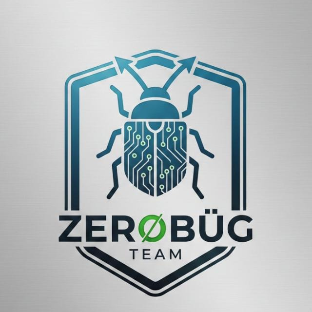

<div align="center">

  <!-- Logo Circular & Tech Badges -->
  

  <br><br>

  
  
  
  

  <br><br>

  <!-- Project Title -->
  <h1>⚡ ZeroBug Team — Portfolio Website</h1>

  <p><strong>Software Design &amp; Engineering Agency Portfolio • High-End STRV-Inspired Architecture</strong></p>

  <p>
    
    
    
    
  </p>

</div>

---

## 🚀 Tentang Project

**Porto-Redesign (v2.1)** adalah website portofolio resmi **ZeroBug Team** yang telah ditransformasikan secara menyeluruh menggunakan framework modern **[Astro](https://astro.build/)** dengan standar visual berkelas dunia yang terinspirasi oleh agensi papan atas global **[STRV](https://www.strv.com)**.

Proyek ini dibangun dari nol dengan pendekatan *component-driven*, performa mendekati instan (*zero-JS footprint by default*), palet warna presisi yang diekstrak langsung dari logo tim, serta penekanan pada tiga pilar rekayasa perangkat lunak:
1. 🌐 **Web Platforms &amp; APIs** (Laravel, PHP, REST API, Docker)
2. 📱 **Mobile Engineering** (Flutter, Android SDK, Firebase)
3. ⚡ **IoT &amp; Embedded Systems** (ESP32, MQTT Protocol, RFID, Sensor Hardware)

---

## 🎨 Desain & Tone Warna (Brand Identity)

Desain website mengadopsi DNA **STRV**: *Dark-first aesthetic*, tata letak kartu sinematik, grid berpendar halus (*high-tech background grid*), dan **logo berbentuk bulat (*circular badge*)** dengan efek pendaran (*cyan glow*).

Tone warna diselaraskan dengan `logo.png`:
* **Deep Charcoal Navy (`#090D12` / `#14232D`)**: Latar belakang utama dan kartu surface, memberikan kesan kokoh dan mewah.
* **Electric Steel Cyan (`#3898B8`)**: Warna aksen utama dari lambang logo untuk tombol CTA, pendaran border, dan sorotan ikon.
* **Cyan Highlight Glow (`#5CC8EB`)**: Gradasi teks headline dan animasi titik aktif (*live pulse dot*).
* **Ice Slate (`#F0F5F8` & `#9DB0BF`)**: Tipografi tajam dan nyaman dibaca di layar gelap maupun terang.

---

## ✨ Fitur Unggulan

| Fitur | Deskripsi |
| :--- | :--- |
| ⚡ **Astro v5 Architecture** | Komponen modular `.astro`, kompilasi super cepat, dan pemisahan logika yang bersih. |
| 🔘 **Circular Logo Badge** | Tampilan logo bulat (`border-radius: 50%`) dengan border berpendar di Navbar dan Footer. |
| 📊 **STRV Impact Metrics Bar** | Sorotan metrik kredibilitas di hero section (*100% Hak Milik Klien, 3 Core Domains, 0-Bug Pledge*). |
| 🎬 **Cinematic Case Studies** | Kartu portofolio dua kolom dilengkapi statistik hasil nyata dan **Live Code Terminal Mockup**. |
| 🍱 **Bento Grid Capabilities** | Tampilan modular untuk 3 pilar layanan utama dengan daftar *deliverables* terperinci. |
| 🌙 **Theme Persistence** | Dark/Light Mode dengan penyimpanan otomatis di `localStorage` (default: **STRV Dark**). |
| 📱 **Mobile-First Drawer** | Navigasi mobile responsif dengan pengunci scroll dan penutup otomatis tombol `Escape`. |
| 🎯 **Value Proposition Grid** | Komparasi transparan antara *Vendor Konvensional* vs *Standar ZeroBug Team*. |

---

## 📂 Struktur Direktori Proyek

```text
Porto-Redesign/
├── public/
│   └── logo.png              # Aset logo bulat, Open Graph image, dan favicon
├── src/
│   ├── components/           # Komponen UI modular Astro
│   │   ├── Header.astro      # Sticky navigation & circular logo
│   │   ├── Hero.astro        # Headline agensi & metrics impact bar
│   │   ├── Projects.astro    # Cinematic case studies & terminal mockups
│   │   ├── Capabilities.astro# Bento grid layanan (Web, Mobile, IoT)
│   │   ├── TechStack.astro   # Ekosistem teknologi teruji
│   │   ├── Process.astro     # Metodologi rekayasa 4 langkah
│   │   ├── Philosophy.astro  # Komparasi nilai bisnis (Why Us)
│   │   ├── CtaBanner.astro   # Callout footer konversi tinggi
│   │   └── Footer.astro      # Footer terstruktur & social links
│   ├── layouts/
│   │   └── Layout.astro      # Master HTML layout, SVG sprites, & theme script
│   ├── pages/
│   │   └── index.astro       # Entry point halaman utama
│   └── styles/
│       └── global.css        # STRV design system, CSS variables, & responsive grid
├── docs/
│   └── analisis-proyek.md    # Dokumen analisis stack STRV & ekstraksi tone warna logo
├── astro.config.mjs          # Konfigurasi Astro
├── package.json              # Dependensi dan script npm
├── tsconfig.json             # Konfigurasi TypeScript
└── README.md                 # Dokumentasi proyek
```

---

## 🛠️ Tech Stack

* **Framework:** [Astro v5](https://astro.build/)
* **Typography:** [Google Fonts](https://fonts.google.com/) (*Space Grotesk*, *Inter*, *JetBrains Mono*)
* **Styling:** Custom CSS3 Design System (CSS Variables, Flexbox, Bento Grid, Backdrop Filter)
* **Iconography:** Inline SVG Symbol System (Zero external icon bloat)
* **Design Inspiration:** [STRV](https://www.strv.com) (Software Design & Engineering Agency)

---

## 🚀 Panduan Menjalankan Proyek

Pastikan Anda telah menginstal **Node.js** (versi 18.17+ atau 20+ direkomendasikan).

### 1. Install Dependensi
Buka terminal di direktori proyek dan jalankan:
```bash
npm install
```

### 2. Jalankan Server Development
```bash
npm run dev
```
Setelah server berjalan, buka browser di:
👉 **`http://localhost:4321`**

### 3. Build untuk Produksi
Untuk mengompilasi website menjadi file statis siap deploy:
```bash
npm run build
```
File hasil build akan tersimpan di dalam folder `dist/`.

### 4. Pratinjau Build Produksi
```bash
npm run preview
```

---

## 📑 Dokumentasi Terkait

Analisis mendalam mengenai benchmark stack agensi global STRV serta hasil ekstraksi warna dari `logo.png` dapat dipelajari di:
* 📄 [`docs/analisis-proyek.md`](docs/analisis-proyek.md)

---

## 🤝 Kontak & Diskusi

Punya proyek atau butuh konsultasi teknis seputar Web, Mobile, atau IoT?

* 💬 **WhatsApp:** [+62 812-2952-3471](https://wa.me/6281229523471)
* 📸 **Instagram:** [@zerobug.team](https://www.instagram.com/zerobug.team)
* 💻 **GitHub:** [@zerobugteam-zekkk](https://github.com/zerobugteam-zekkk)

---

<div align="center">
  <sub>© 2026 ZeroBug Team • Built with ❤️ using Astro &amp; Clean Code Architecture</sub>
</div>
